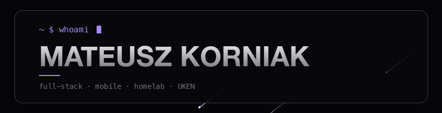

# Hi, I'm Mateusz 

  

  

  
  

## Portfolio

My portfolio lives at [mateuszkorniak.pl](https://mateuszkorniak.pl).

## About me

- 📍 Skawina / Kraków, studying Applied Computer Science at UKEN (Uniwersytet Komisji Edukacji Narodowej w Krakowie)
- 💼 Full-Stack Engineer focused on Go backend and Flutter apps, currently at Holiday Polen (remote)
- 🗣️ Polish (native), English (B2/C1)
- 🔭 Working on: a few self-hosted projects, a Flutter client for the USOS API, and the BitFlip student club site
- 🧪 Into: homelab, Docker, Polish-language docs, and easter eggs hidden in UIs

## Projects

- **[Portfolio-Website](https://github.com/ZiQu-dev/Portfolio-Website)**: this portfolio, Astro + React islands + Tailwind 4, with a small private debt-splitting app behind `/dlugi`.
- **UkenMate**: unofficial Flutter client for the USOS API at UKEN. Read-only by design, Polish UI, a cat walks along the nav bar on purpose. *(Private Forgejo repo.)*
- **[BitFlip club site](https://bitflip.mateuszkorniak.pl/)**: website for a student science club at UKEN. Astro 5 with React, Postgres for event sign-ups, voting and a member panel, deployed with Docker behind Caddy.
- **[MBM Electronics](https://www.mbm.krakow.pl/)**: new company site for a Kraków AV and IT firm (in business since 1993), built from scratch in Astro to replace WordPress. Includes SEO, 301 redirects and a contact form with its own mailer.
- **Prawko Plus**: driving-theory learning platform. Go API with video streaming and FFmpeg transcoding, a Flutter app, and Docker Compose behind Caddy. [Demo](https://pp.mateuszkorniak.pl/)
- **Holiday Polen**: booking system for hotels and holiday cottages, a private alternative to booking.com on the client's own domain. Go REST API with PostgreSQL. [Client site](https://holidaypolen.de/)
- **EMPE**: Qt desktop app that visualises and records live data from two lidar devices over COM ports.

## Experience

- **MBM Electronics**, Web Developer and IT administration, Kraków (09.2026 – now)
- **Holiday Polen**, Full-Stack Engineer, remote (12.2025 – now)
- **Aegis Consulting**, Mobile / Full-Stack, hybrid (06.2025 – 03.2026): Prawko Plus
- **Komputrex**, IT administrator / service desk (06.2024 – 10.2024, 03.2026)
- **ManufaqturaHR**, Front-End Developer, WordPress (04.2024 – 10.2024)

## Tech stack

  

<!-- Icons taken from the repos I actually work in. Check which ids exist at https://skillicons.dev -->

## Stats

  

## Contributions: GitHub + Forgejo

  

  

Both calendars count GitHub contributions plus commits from my self-hosted Forgejo, including org repos. Teal = a day where Forgejo led. Repos migrated or mirrored from GitHub are left out, so the import history doesn't inflate the numbers.

## How this profile is built

This repo lives on GitHub, but the build runs on my own Forgejo:

- **Forgejo** is the source of truth. It runs `.forgejo/workflows/forgejo-stats.yml` on my local runner every 6 hours. The job calls the Forgejo API and GitHub, renders the calendars and the stats card with [`scripts/forgejo_stats.py`](scripts/forgejo_stats.py) (stdlib Python, no dependencies), and commits the SVGs.
- **Images** are served from my own server (three SVG files behind Caddy), so the numbers stay fresh without pushing to GitHub.
- **Banner** is an animated GIF, generated once locally by [`scripts/make_banner.py`](scripts/make_banner.py) and committed. It doesn't change on each run.

---

## Contact

  
  
  

